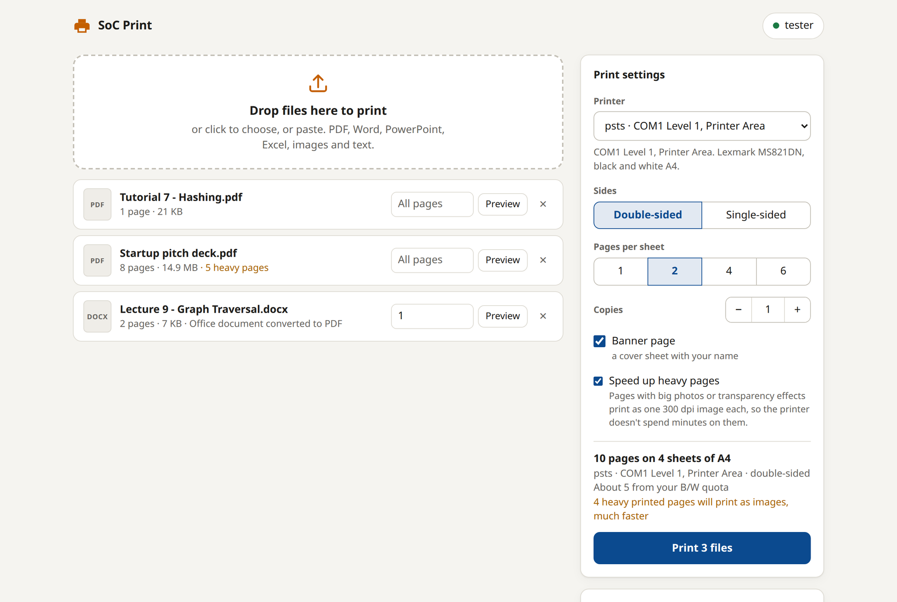
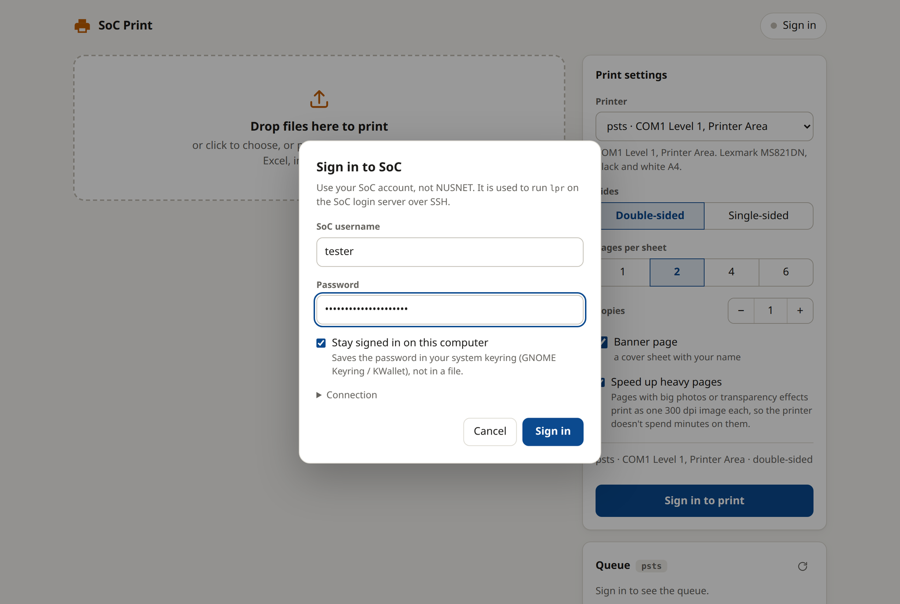
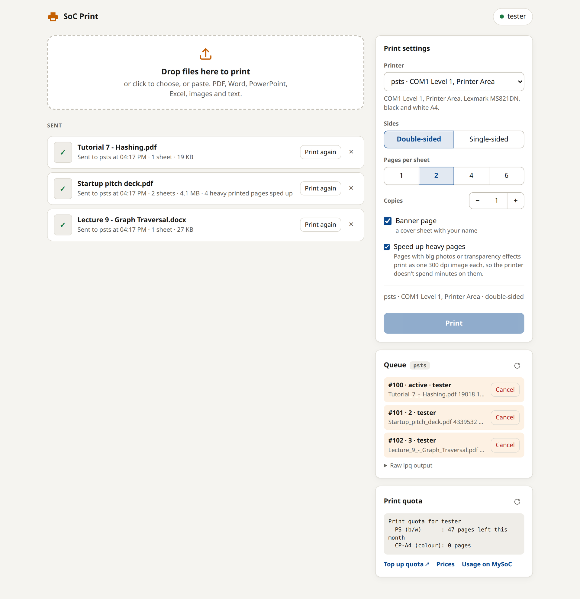
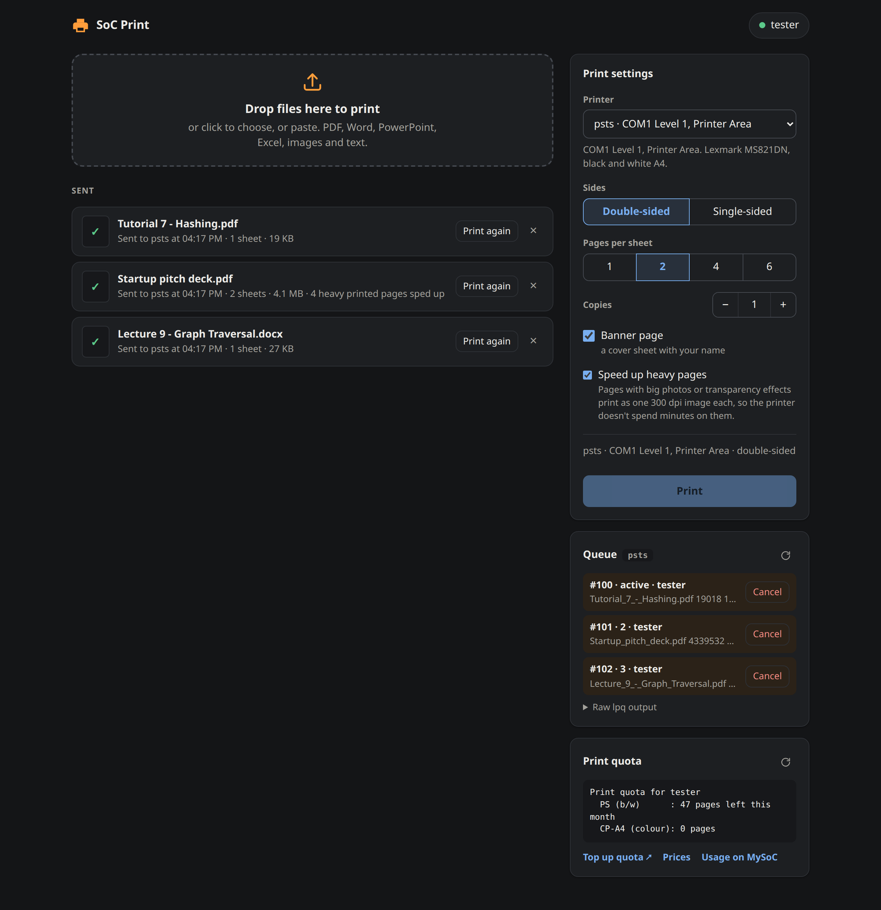

# SoC Print

[](https://github.com/randomwish/soc-print/actions/workflows/ci.yml)

A local web page for printing on NUS School of Computing printers: drop files on
it, pick a printer, press Print. You sign in once; after that it stays signed in.



## Download

Standalone builds need nothing else installed (no Python, no uv):

| System | Download |
| --- | --- |
| Windows (64-bit) | [soc-print-windows-x86_64.zip](https://github.com/randomwish/soc-print/releases/latest/download/soc-print-windows-x86_64.zip) |
| macOS (Apple Silicon) | [soc-print-macos-arm64.tar.gz](https://github.com/randomwish/soc-print/releases/latest/download/soc-print-macos-arm64.tar.gz) |
| Linux (x86-64, glibc 2.35+, e.g. Ubuntu 22.04 or newer) | [soc-print-linux-x86_64.tar.gz](https://github.com/randomwish/soc-print/releases/latest/download/soc-print-linux-x86_64.tar.gz) |

Unpack it and run `soc-print` (`soc-print.exe` on Windows). A terminal window
stays open while it runs; close it to stop SoC Print. Everything below (sign
in, printing, `soc-print install`) works the same way.

The builds aren't code-signed, so the first launch needs one extra click:

- **Windows:** SmartScreen says "Windows protected your PC". Click
  **More info**, then **Run anyway**.
- **macOS:** run `xattr -d com.apple.quarantine soc-print` in the folder you
  unpacked it to, or right-click it in Finder and choose **Open**.

Intel Macs and other systems can run it from source, as below. All releases
are on the [Releases page](https://github.com/randomwish/soc-print/releases).

## Quick start (from source)

**You need:** a SoC Unix account (not your NUSNET account), git, and
[uv](https://docs.astral.sh/uv/). On Linux and macOS, also the OpenSSH client
(`ssh`, usually already there); Windows doesn't need it.

Optional: [LibreOffice](https://www.libreoffice.org/) to print Word,
PowerPoint, Excel and text files (PDFs and images work without it), and
[Ghostscript](https://ghostscript.com/releases/gsdnld.html) for
"Speed up heavy pages". Both are found in their standard install folders.

1. **Install uv** if you don't have it.

   Linux and macOS:

   ```
   curl -LsSf https://astral.sh/uv/install.sh | sh
   ```

   Windows (PowerShell):

   ```
   powershell -ExecutionPolicy ByPass -c "irm https://astral.sh/uv/install.ps1 | iex"
   ```

2. **Get SoC Print and start it:**

   ```
   git clone https://github.com/randomwish/soc-print.git
   cd soc-print
   ./soc-print          # Linux and macOS
   .\soc-print.cmd      # Windows (or double-click soc-print.cmd)
   ```

   The first run installs the Python dependencies into `./.venv`, then opens
   http://127.0.0.1:6310/ in your browser.

3. **Sign in** with your SoC username and password. Leave "Stay signed in"
   ticked to keep the password in your system keyring, so you don't have to
   sign in again.

   Off the SoC network, SoC Print goes through the `stujump` jump host. That
   only works from inside NUS: use NUS VPN from home, and on NUS Wi-Fi register
   this device's SSH key with `skeys` first (see the DocHub "SSH Jump Host Guide").

   

4. **Drop files** on the page (or click it to choose files, or paste). Pick a
   printer, then choose sides, pages per sheet and copies. To print only part
   of a file, type a range such as `1-3,7` in that file's box. **Preview** shows
   the exact PDF that will be sent.

5. **Press Print.** Sent files move to the **Sent** list, where you can print
   them again. The **Queue** panel shows your jobs on that printer, each with a
   Cancel button, and **Print quota** shows how many pages you have left.

   

6. **Optional:** run `./soc-print install` (Windows: `soc-print.cmd install`)
   to start SoC Print at login and add it to your app menu or Start menu.
   `uninstall` undoes it.

| Command (Windows: `soc-print.cmd …`) | What it does |
| --- | --- |
| `./soc-print` | Start the site and open it in the browser |
| `./soc-print --port 6400` | Use another port |
| `./soc-print --no-open` | Start without opening a browser |
| `./soc-print install` | Start at login and add a menu shortcut (Linux with systemd, Windows) |
| `./soc-print uninstall` | Undo `install` |

The page follows your system's light or dark theme.

### Supported systems

| System | Status |
| --- | --- |
| Linux | Works. Tested in CI on Ubuntu with Python 3.10 and 3.13. |
| macOS | Works. Tested in CI. `install` isn't available (it needs systemd). |
| Windows | Works. Tested in CI (Windows Server runners) with Python 3.10 and 3.13, including `soc-print.cmd` and `install`. |

CI runs the full test suite (sign-in, printing, the jump-host route, host-key
pinning, against `tests/fake_soc.py`) and a start-up check on each system, and
the Linux suite once more on the Windows SSH backend. It never contacts SoC.



## How it works

SoC printing from Unix is `lpr -P <queue> <file>` on the login server
(`stu.comp.nus.edu.sg` for students, `stf` for staff), and the print servers
only accept PDF, PostScript and plain text. So SoC Print:

1. converts whatever you drop to PDF on your machine, and scales it onto the
   printer's paper size (a Letter or slide-shaped page otherwise stalls the
   printer on "wrong paper size");
2. applies page ranges, pages-per-sheet and copies to that PDF, which is also
   what Preview shows;
3. sends it over SSH and runs the documented `lpr` command. The temporary copy
   on the server is deleted as soon as `lpr` has taken it.

### Heavy pages

Exported decks (AI slide generators, Canva and the like) often put a 4K photo
behind every slide and draw glows with transparency. The printer has to
composite all of that at full resolution, which is why such jobs sit at
"Processing" for minutes. When a file is added, SoC Print looks for pages with
more than 12 MP of images, soft masks, transparency over large images, or
megabytes of vector drawing. With "Speed up heavy pages" on (the default), only
those printed pages are sent as one 300 dpi image each (grayscale for B/W
queues). Text-only pages are left untouched, and Preview shows exactly what
will be sent.

On a synthetic 10-slide deck of that kind (2 per sheet), this took the job from
18.7 MB to 2.8 MB, the PostScript a print server would make from it from 107 MB
to 3.6 MB, and Ghostscript's 600 dpi render time from 6.7 s to 0.4 s. Those are
proxies; the printer itself wasn't timed.

The queue panel is `lpq -P <queue>`, Cancel is `lprm`, and the quota panel is
`pusage`, with links to top up (socpay.comp.nus.edu.sg), prices and MySoC usage. The printer list comes from the DocHub print-queues page, including
the `-sx` (single-sided), `-dx` (double-sided colour) and `-nb` (no banner)
variants; any other queue can be typed in under "Another queue…".

It is a local site rather than a hosted one because it has to reach SoC's
servers from your network position and use your credentials, neither of which
should leave your computer.

## Staying signed in

- The password is stored in the operating system keyring (GNOME Keyring /
  KWallet, macOS Keychain, Windows Credential Manager), never in a file. Untick
  "Stay signed in" to keep it in memory only until SoC Print stops.
- One SSH connection is kept open and reused for every command, so the server
  sees one login, not one per print job. It reconnects by itself when needed.
  On Linux and macOS this is the system `ssh` with a shared master connection
  (ControlMaster). Windows' OpenSSH can't share connections, so there SoC Print
  holds the connection itself, using [paramiko](https://www.paramiko.org/).
- A password is offered once per connection attempt. If the server rejects a
  saved password (say you changed it), it is deleted and you are asked again;
  it is never retried, so a stale password can't lock the account.
- Sign out (click your username) closes the connection and deletes the saved
  password.

Connection route is automatic: direct to `stu` when it is reachable (SoC
network), otherwise through `stujump`. The jump host asks for the same password,
only accepts connections from inside NUS (use NUS VPN elsewhere), and on NUS
Wi-Fi also requires this device's SSH key to be registered with `skeys`; see
the DocHub "SSH Jump Host Guide".

## Security notes

- The server listens on 127.0.0.1 only. Every API call needs a per-run token
  that only the page itself knows, and the Host header is checked, so other
  websites open in your browser cannot make it print.
- On Linux and macOS, ssh is given the password through a private unix socket
  by a helper (`SSH_ASKPASS`), so it never appears in a command line or
  environment variable. On Windows the password never leaves the SoC Print
  process.
- Unknown SSH host keys are accepted on first connection and pinned in
  `~/.ssh/known_hosts`; a changed key stops everything. Both SSH backends use
  the same file, and the Windows one only ever appends to it.

## Files

| Path | What it holds |
| --- | --- |
| `~/.config/soc-print/config.json` | Username, route and last-used print settings. `host`, `port`, `jump_host`, `jump_port` can be edited by hand. |
| `~/.cache/soc-print/` | Files being prepared (wiped on start and exit) and a private LibreOffice profile. |
| `$XDG_RUNTIME_DIR/soc-print/` | SSH control socket and the password helper's socket (removed on exit). Not used on Windows. |

On Windows, `~` is your user folder (`C:\Users\<you>`).

`SOC_PRINT_SSH_ARGS` adds arguments to every `ssh` invocation, for example
`-o IdentityFile=~/.ssh/other_key`. The Windows backend understands
`UserKnownHostsFile`, `IdentityFile` (or `-i`), `PubkeyAuthentication` and
`IdentityAgent=none`; write paths with forward slashes.
`SOC_PRINT_SSH_BACKEND=paramiko` (or `openssh`) picks the SSH backend.

## Development

```
uv run pytest
```

Standalone builds come from PyInstaller:

```
uv run --with "pyinstaller>=6.10" python packaging/build.py
uv run python tests/smoke_exe.py dist/soc-print
```

`tests/smoke_exe.py` signs in, prints and checks the quota through the built
executable against the fake server. The Build workflow does both on Linux,
macOS and Windows for every push; pushing a `v*` tag also publishes the
archives as a GitHub release.

The tests start `tests/fake_soc.py`, a real SSH server with fake `lpr`, `lpq`,
`lprm` and `pusage`, so sign-in, connection reuse, the jump-host route and
printing are exercised through the actual `ssh` client without touching SoC or
your keyring. Run them on the Windows backend with
`SOC_PRINT_SSH_BACKEND=paramiko uv run pytest`. On Windows the fake server
needs Git for Windows (for `sh`).

### Trying it without printing

Start the fake server, then run SoC Print against it with throwaway settings:

```
uv run python tests/fake_soc.py --port 2222 --state /tmp/fake-soc &

export XDG_CONFIG_HOME=/tmp/sp-demo/config XDG_CACHE_HOME=/tmp/sp-demo/cache
export XDG_DATA_HOME=/tmp/sp-demo/data XDG_RUNTIME_DIR=/tmp/sp-demo/run
mkdir -p $XDG_CONFIG_HOME/soc-print $XDG_RUNTIME_DIR
echo '{"host": "127.0.0.1", "port": 2222, "jump_host": "localhost", "jump_port": 2222}' \
  > $XDG_CONFIG_HOME/soc-print/config.json
export PYTHON_KEYRING_BACKEND=keyrings.alt.file.PlaintextKeyring
export SOC_PRINT_SSH_ARGS="-F /dev/null -o UserKnownHostsFile=/tmp/sp-demo/known_hosts -o PubkeyAuthentication=no"
uv run python -m socprint --port 6311
```

Sign in as `tester` with the password printed in `tests/conftest.py`. "Printed"
files land in `/tmp/fake-soc/jobs/`.
